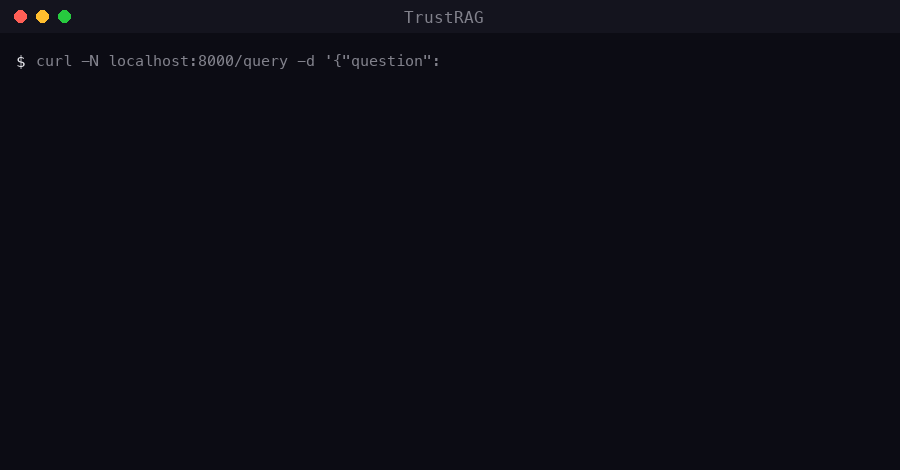

# TrustRAG — a RAG platform that proves its answers

Most RAG demos hallucinate confidently. TrustRAG **shows its work**: every
claim in every answer is machine-verified against the retrieved evidence,
citations link to the exact source chunks, the system **abstains** when
confidence is low — and a built-in evaluation harness puts numbers on all of it.

```
Q: How many vacation days can I carry over?
→ "Employees may carry over a maximum of five (5) vacation days [1]"
   claim [verified] · confidence 0.8 · citation → employee_handbook.md chunk 0

Q: What is the stock options vesting schedule?
→ "I don't have enough confidence in the retrieved evidence to answer."
   abstained · the corpus says nothing about stock options
```



## What makes it different

| Feature | What it means here |
|---|---|
| **Trust layer** | Second LLM pass extracts atomic claims and checks entailment against retrieved passages → `verified / unsupported / contradicted` per claim, persisted for analysis |
| **Confidence & abstention** | `0.6 × verified_fraction + 0.4 × retrieval_strength`; below 0.5 the system refuses and explains why |
| **Hybrid retrieval** | pgvector cosine (HNSW) + Postgres full-text (BM25) fused with Reciprocal Rank Fusion in a single SQL query; chunks found by both legs rank highest |
| **Eval-in-the-loop** | 16-question golden dataset scored through the real pipeline (see below); results stored per git SHA for regression tracking |
| **Tracing** | Langfuse traces every stage: retrieval → generation → verification |
| **Multi-tenant by construction** | Tenant isolation enforced inside the retrieval SQL, never post-filtered |

## Eval results (first run, local models)

| Metric | Score |
|---|---|
| retrieval_hit_rate (12 answerable) | **1.00** |
| answer_success_rate | **1.00** |
| abstention_accuracy (4 unanswerable) | **1.00** |
| mean_confidence | 0.90 |

Run it yourself: `make eval`.

## Quickstart (one machine, no API keys)

Prerequisites: Docker, [Ollama](https://ollama.com) with two models pulled,
Python 3.12 via [uv](https://docs.astral.sh/uv/).

```bash
ollama pull bge-m3 && ollama pull qwen2.5:7b   # once
cp .env.example .env
make install && make compose-up                # api, worker, postgres+pgvector, redis, langfuse, pgadmin
curl localhost:8000/health                     # {"status":"ok"}
```

Then try it:

```bash
# 1. register a tenant + user, get a JWT (see /docs for the full API)
TOKEN=$(curl -s -X POST localhost:8000/auth/register -H 'Content-Type: application/json' \
  -d '{"tenant_name":"Acme","email":"me@acme.io","password":"a-long-password-1"}' >/dev/null \
  && curl -s -X POST localhost:8000/auth/token \
  -d 'username=me@acme.io&password=a-long-password-1' | python3 -c 'import json,sys; print(json.load(sys.stdin)["access_token"])')

# 2. upload a document (worker parses → chunks → embeds → indexes it)
curl -F "file=@handbook.md" -H "Authorization: Bearer $TOKEN" localhost:8000/documents

# 3. ask a question — SSE stream with citations, claim verdicts, confidence
curl -N -X POST localhost:8000/query -H "Authorization: Bearer $TOKEN" \
  -H 'Content-Type: application/json' -d '{"question": "How many vacation days carry over?"}'
```

- API docs (Swagger): http://localhost:8000/docs
- Langfuse traces: http://localhost:3000 (sign up once, keys in `.env`)
- pgAdmin: http://localhost:5050 (`admin@trustrag.dev` / `trust_rag_dev`)

## Architecture

See [docs/architecture.md](docs/architecture.md) for mermaid diagrams and the
rationale behind each decision. In one paragraph: FastAPI (async, SSE) in front
of Postgres+pgvector doing hybrid dense/BM25 retrieval with RRF; an Arq worker
runs the ingestion pipeline (parse → chunk → embed → index, idempotently);
generation and verification run on a local Ollama (OpenAI-compatible, so any
provider is a `.env` swap); Langfuse traces each stage; every query and claim
verdict is persisted for the eval harness.

```
trust_rag/            core package (no framework coupling)
  ingestion/          parsers, chunker, pipeline
  retrieval/          hybrid search (RRF SQL)
  generation/         LLM seam (LiteLLM → Ollama/Z.ai/OpenAI)
  verification/       claim extraction + entailment (the trust layer)
  eval/               golden-dataset harness → eval_runs/eval_scores
api/                  FastAPI routers, auth deps, schemas
tests/                44 tests (integration against real Postgres/Redis,
                      LLM + embeddings mocked — 14s, no network)
```

## Stack

Python 3.12 · FastAPI · SQLAlchemy 2 (async) · Alembic · PostgreSQL 16 + pgvector ·
Redis + Arq · LiteLLM · Langfuse v2 · uv · Docker Compose · GitHub Actions

## Status

- [x] v1 — trustworthy pipeline: auth (JWT + API keys, multi-tenant), upload +
      storage, ingestion, hybrid retrieval, SSE query with citations, claim
      verification + abstention, tracing, eval harness. 44 tests, evals green.
- [ ] v2 — dashboard, A/B retrieval playground, semantic cache, chat memory
- [ ] v2.5 — temporal RAG ("as of March 2024…", contradiction surfacing)
- [ ] v2.6 — agentic mode (LangGraph)
- [ ] v3 — MCP server (`rag.search` from any MCP client)
- [ ] 11b (optional) — Terraform → AWS deploy

Full plan: [BUILD_PLAN.md](BUILD_PLAN.md).
