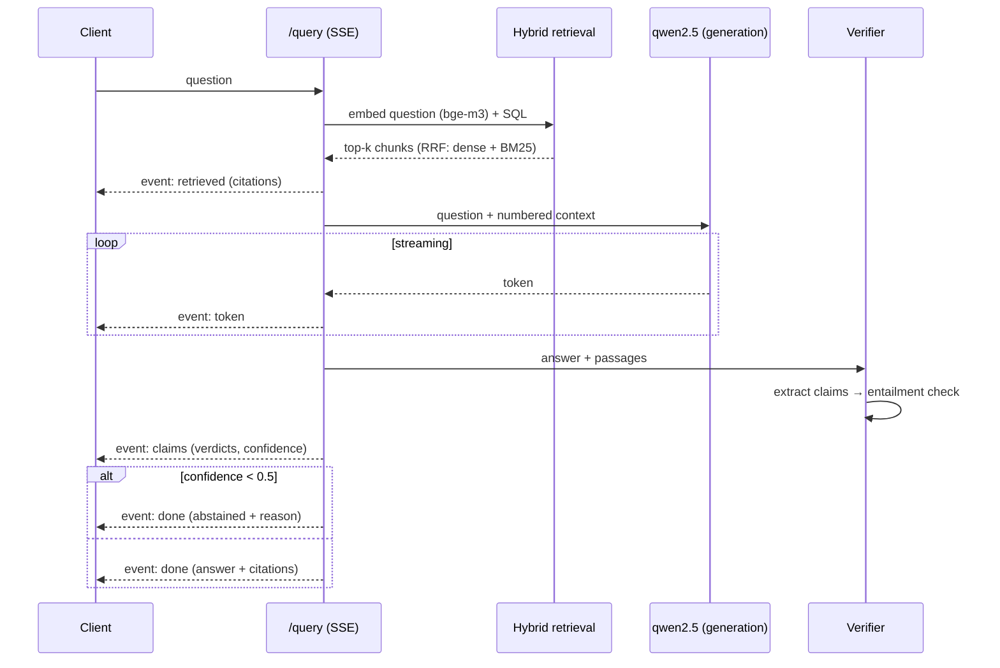

# TrustRAG Architecture

## System overview

```mermaid
flowchart TB
    subgraph Client
        UI[Client / curl]
    end

    subgraph API["FastAPI (async)"]
        AUTH[Auth: JWT + API keys\n→ AuthContext(tenant)]
        UPLOAD[POST /documents]
        QUERY[POST /query → SSE]
    end

    subgraph Worker["Arq worker"]
        ING[Ingestion pipeline\nparse → chunk → embed → index]
    end

    subgraph Storage["PostgreSQL + pgvector"]
        CHUNKS[(chunks:\nembedding vector(1024) HNSW\n+ tsvector GIN)]
        DOCS[(documents / tenants / users / api_keys)]
        LOGS[(query_logs + claims\n+ eval_runs / eval_scores)]
    end

    REDIS[(Redis\njob queue)]
    FS[(Object storage\n./data/<tenant>/<doc>)]

    subgraph Ollama["Ollama (OpenAI-compatible)"]
        BGE[bge-m3 embeddings]
        QWEN[qwen2.5:7b\ngeneration + verification]
    end

    LF[Langfuse v2\ntracing UI :3000]

    UI -->|upload| AUTH --> UPLOAD
    UI -->|question| AUTH --> QUERY
    UPLOAD -->|enqueue| REDIS --> ING
    ING --> FS
    ING --> BGE
    ING --> CHUNKS
    QUERY -->|hybrid search\nRRF fusion| CHUNKS
    QUERY -->|grounded answer| QWEN
    QUERY -->|claim verification| QWEN
    QUERY -.->|spans| LF
```

## The query path (with the trust layer)



## Key design decisions

| Decision | Why |
|---|---|
| **Postgres + pgvector** (one DB for relational + vectors + full-text) | Hybrid search without a separate vector DB; tenant isolation enforced in SQL inside both retrieval CTEs |
| **RRF fusion** (k=60, 50 candidates/leg) | Chunks found by *both* dense and BM25 legs rank highest — cheap, tunable, no retraining |
| **Verification via the same LLM stack** (`acomplete_json`) | The trust layer doubles as the eval scorer — no external LLM-judge dependency |
| **Null-object observability seam** | Langfuse tracing is a no-op when disabled; business code never branches on it |
| **Engine in app lifespan + startup retries** | asyncpg pools bind to one event loop; services race on cold starts |
| **Ollama via OpenAI-compatible API** | Free local inference; any provider (Z.ai, OpenAI) is a `.env` swap — no code changes |
| **Idempotent ingestion** (delete-then-insert per document) | Failed jobs re-run safely; no duplicate chunks |

## Data model (core tables)

```
tenants ─┬─ users ────── (JWT auth)
         ├─ api_keys ─── (hashed, prefix for display)
         └─ documents ─┬─ chunks (embedding vector(1024), tsv,
         │   │           valid_from/valid_to  ← temporal RAG ready)
         │   └─ ingestion_jobs
         └─ query_logs ── claims (verified/unsupported/contradicted,
                         supporting chunk ids)
eval_runs ── eval_scores (metric history per git SHA)
```

## Multi-tenancy

Every owned row carries `tenant_id` (denormalized onto `chunks`), and every
query path filters on it **inside SQL** — a chunk from another tenant cannot
surface in retrieval results, list endpoints, or deletion. Auth resolution
(`JWT | X-API-Key → AuthContext`) is the single chokepoint.
